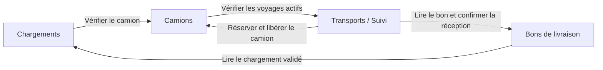

# Transport de marchandises - Web Services

Préparer les marchandises, émettre un bon de livraison et suivre le voyage du camion.

**4 backends Spring Boot, une base PostgreSQL commune sur Neon, des échanges REST / JSON.**
Le backend **Chargements** est implémenté. Les trois autres backends restent à développer.
Voir [démarrage, routes et exemples Chargements](services/chargements/README.md).

## Ma partie

| Étudiant | Module | Son guide |
|---|---|---|
| Ibnahmad Hassan | Camions | [Fonctions, classes et API](services/flotte/README.md) |
| Sina Oussama | Chargements | [Fonctions, classes et API](services/chargements/README.md) |
| Aitlahmous Hmad | Bons de livraison | [Fonctions, classes et API](services/bons/README.md) |
| Chammakh Ayoub | Suivi des transports | [Fonctions, classes et API](services/transports/README.md) |

## Les diagrammes

[Diagramme de classes du système](docs/diagramme-classes.md)

Une flèche signifie « appelle ce module » :



## La base commune

Les quatre backends se connectent à **la même base Neon**. Chaque module gère ses tables.
Les échanges métier entre modules passent par leurs API, même avec une base commune.
Les accès sont transmis en privé et configurés dans l’IDE ou dans les variables d’environnement.
Voir [.env.example](.env.example) pour les noms des variables. Aucun mot de passe dans Git.
Les huit tables sont créées sur Neon. Voir [les tables et les comptes par module](database/README.md).

Une copie locale facultative de PostgreSQL peut être lancée avec :

```sh
cp .env.example .env
docker compose up -d
```

Ce Compose lance uniquement une base locale vide ; la migration initiale se trouve dans `database/`.
Le module Chargements possède son Dockerfile. Les autres Dockerfiles et le Compose
des quatre backends seront ajoutés pendant l’intégration.

## Travailler ensemble

Chacun travaille dans son dossier `services/`. Créer une branche, pousser ses changements,
puis ouvrir une pull request vers `main`. Les changements de tables se décident ensemble.
Chaque backend documentera ses routes avec Swagger / OpenAPI.
