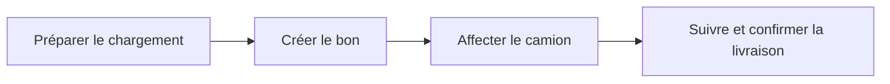

# Transport de marchandises — Projet Web Services

Une application pour **préparer un chargement, créer son bon de livraison, affecter un camion et suivre le transport jusqu'à la livraison**.

> **État du dépôt : base de démarrage.** Documentation, modèles de données, contrats d'API et infrastructure des bases sont fournis. Les quatre backends métier restent à développer. Les étudiants et leurs frameworks restent à choisir.

## Les quatre modules

| Étudiant | Backend | Son travail principal | Il appelle |
|---|---|---|---|
| 1 — à désigner | [Flotte / Camions](services/flotte/README.md) | Camions, capacité, disponibilité et maintenance | Transports |
| 2 — à désigner | [Chargements](services/chargements/README.md) | Marchandises, poids et destination | Flotte |
| 3 — à désigner | [Bons de livraison](services/bons/README.md) | Document de livraison et confirmation de réception | Chargements |
| 4 — à désigner | [Transports / Suivi](services/transports/README.md) | Affectation du camion, départ, suivi et livraison | Bons + Flotte |

Chaque backend **expose une API REST et consomme une autre API**. Il possède sa propre base logique. Une interface commune pourra appeler les quatre API.



## Commencer sans tout lire

1. Lire [le démarrage en équipe](docs/00-demarrer.md).
2. Choisir son module puis ouvrir son guide dans le tableau ci-dessus.
3. Partager [les règles de communication](docs/04-communication-api.md) avant de coder les échanges.

## Documentation

| Besoin | Document |
|---|---|
| Comprendre les fonctionnalités | [Périmètre fonctionnel](docs/01-fonctionnel.md) |
| Comprendre les quatre backends | [Architecture générale](docs/02-architecture.md) |
| Voir les classes, relations et bases | [Modèle de données](docs/03-modele-donnees.md) |
| Savoir qui appelle qui | [Communication et scénario global](docs/04-communication-api.md) |
| Répartir le travail | [Organisation et suivi](docs/05-organisation.md) |
| Démarrer les bases, intégrer et tester | [Intégration et tests](docs/06-integration-tests.md) |
| Préparer la présentation de 10 minutes | [Support simple et plan oral](docs/07-presentation.md) |
| Comprendre les décisions proposées | [Décisions et hypothèses](docs/08-decisions.md) |
| Consulter les schémas REST | [Contrats OpenAPI](contracts/README.md) |
| Retrouver les diagrammes modifiables | [Catalogue des diagrammes](docs/diagrams/README.md) |
| Prévoir une interface commune | [Rôle du frontend](frontend/README.md) |

## Ce qui fonctionne dès maintenant

Pour récupérer le dépôt :

```sh
git clone https://github.com/UssamaRei/transport-marchandises-ws.git
cd transport-marchandises-ws
```

- Lire les guides et les diagrammes dans GitHub.
- Valider les contrats OpenAPI et leurs exemples avec [le script fourni](scripts/README.md).
- Lancer **uniquement les quatre bases PostgreSQL d'exemple** :

```sh
cp .env.example .env
docker compose config
docker compose up -d
docker compose ps
```

Sous PowerShell, remplacer la première commande par `Copy-Item .env.example .env`. Adapter les mots de passe de développement dans `.env` avant lancement ; ce fichier est ignoré par Git.

PostgreSQL est une **proposition pour démarrer**, pas une technologie imposée à l'équipe. Les scripts SQL sont des schémas de référence ; chaque étudiant peut les traduire en migrations avec son framework.

Le [Compose des backends](compose.backends.example.yaml) est un **gabarit à compléter** : il nécessite le code, les migrations et les Dockerfiles des quatre services. Le dépôt ne contient pas encore une application métier exécutable.

## Organisation du dépôt

```text
services/           4 espaces de travail, guides et schémas SQL
contracts/          4 contrats REST et exemples JSON
docs/               explications, diagrammes et présentation
scripts/            validation de la documentation et des contrats
tests/integration/  scénarios communs à implémenter
frontend/           rôle de l'interface commune, technologie à choisir
compose.yaml        4 bases de développement
```

Projet du module **Web Services**, équipe de quatre étudiants. Le sujet fourni demande Docker, Compose, un dépôt GitHub commun, la documentation des services et une démonstration. **Livraison : 20 novembre 2026 ; soutenances à partir du 26 novembre 2026.** Les détails de conception de ce dépôt sont des propositions à valider ensemble.
