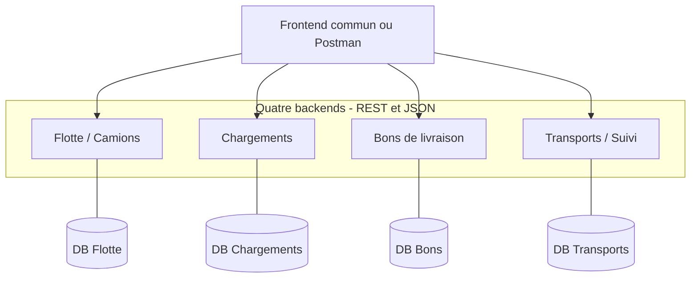

# Architecture générale

## Une application, quatre backends

Il n'y a pas besoin d'un cinquième backend commun. Chaque service possède sa logique et sa base. Une interface commune ou Postman permet d'utiliser les quatre APIs.

Les flèches d'entrée représentent les appels de l'interface ; les liens aux bases représentent les accès locaux de chaque service. Les échanges métier entre backends sont détaillés dans [la matrice des appels et le scénario de livraison](04-communication-api.md).

## Pourquoi REST et JSON ?

Les services échangent des requêtes HTTP et des données JSON, indépendamment de leurs langages. Un backend Java peut appeler un backend Python, PHP ou JavaScript si leurs contrats s'accordent.

## Bases de données

Un **modèle métier commun** permet de comprendre les relations. Le stockage reste séparé par module. `camionId` dans un autre backend est une référence à une ressource Flotte, pas une permission de lire ses tables.

Les quatre bases peuvent tourner sur le même PC. On pourrait aussi héberger quatre bases logiques dans un seul serveur de base de données avec des utilisateurs distincts. Aucun hébergement public n'est requis par le sujet fourni.

## Adresses proposées

| Service | Depuis le PC | Depuis un autre backend dans Compose |
|---|---|---|
| Flotte | `http://localhost:8081/api/v1` | `http://flotte:8080/api/v1` |
| Chargements | `http://localhost:8082/api/v1` | `http://chargements:8080/api/v1` |
| Bons | `http://localhost:8083/api/v1` | `http://bons:8080/api/v1` |
| Transports | `http://localhost:8084/api/v1` | `http://transports:8080/api/v1` |

Chaque application doit écouter sur `0.0.0.0:8080` dans son conteneur. Docker Compose permet la découverte par nom de service ; les appels entre conteneurs utilisent le port interne. `localhost` dans un conteneur désigne ce conteneur. Voir [la documentation Docker](https://docs.docker.com/compose/how-tos/networking/).

Le navigateur du PC utilise les ports publiés ou un proxy frontend. Si le frontend appelle les quatre ports, configurer son origine CORS dans chaque backend.

## Dépendances sans boucle d'appels

Flotte appelle Transports **seulement avant une maintenance**. La lecture des transports actifs consulte uniquement la base Transports. La réservation chez Flotte ne rappelle pas Transports. Les dépendances entre modules ne doivent donc pas produire une récursion HTTP.

Les applications attendent seulement leur propre base au démarrage et traitent explicitement les erreurs des autres APIs. Leur santé locale ne doit pas dépendre de la santé de tous les services voisins.
