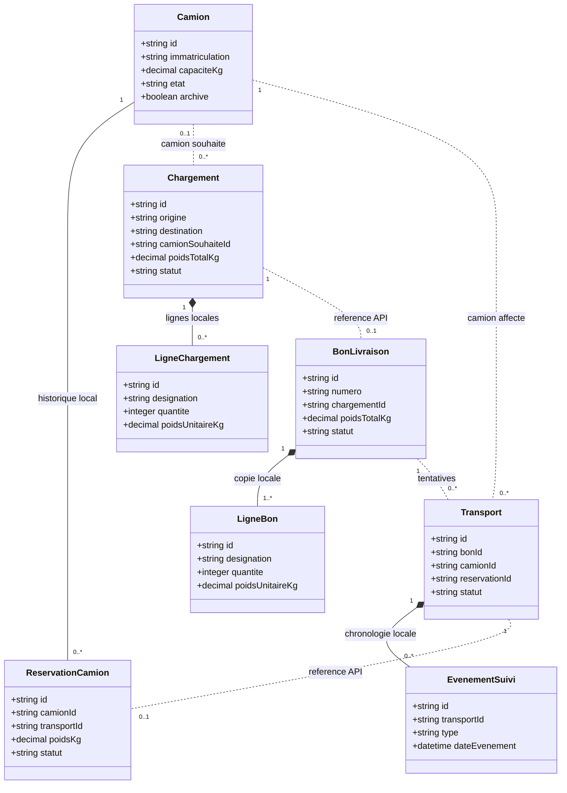

# Modèle commun et bases séparées

## Comprendre les relations

Le diagramme suivant est **conceptuel**. Il réunit les classes pour comprendre le projet ; il ne représente pas une base SQL commune.

Les lignes locales et le camion souhaité sont facultatifs en brouillon, mais **au moins une ligne et un camion sont obligatoires pour valider**. Un bon n'a qu'un transport non annulé à la fois. Une intention de transport peut n'avoir aucune réservation pendant sa préparation.

## Propriété des données

| Base | Tables du service | Identifiants externes, sans FK SQL |
|---|---|---|
| Flotte | `camion`, `reservation_camion` | `reservation_camion.transport_id` |
| Chargements | `chargement`, `ligne_chargement` | `chargement.camion_souhaite_id` |
| Bons | `bon_livraison`, `ligne_bon` | `chargement_id`, `camion_souhaite_id`, `transport_preuve_id` |
| Transports | `transport`, `evenement_suivi` | `bon_id`, `camion_id`, `reservation_id` |

**FK locale :** une ligne appartient à un chargement dans la même base. **Référence externe :** un transport stocke un `bonId` et consulte le bon via l'API de Bons.

## Champs et règles

| Entité | Champs importants et contraintes |
|---|---|
| Camion | `id`, immatriculation unique, capacité positive, état `EN_SERVICE` ou `MAINTENANCE`, archivage. `disponible` est calculé, pas saisi librement. |
| Réservation | Camion local, transport externe unique, poids, statut `ACTIVE`/`LIBEREE`, dates et motif de libération. Une ACTIVE par camion. |
| Chargement | Origine, destination, destinataire `{nom, telephone}`, camion souhaité, poids calculé, état `BROUILLON`/`VALIDE`, version de concurrence. |
| Ligne de chargement | Chargement local, désignation, quantité entière positive et poids unitaire positif. |
| Bon | Numéro unique, chargement externe unique, copie des adresses, destinataire, camion souhaité et poids ; état `EMIS`/`LIVRE`. |
| Ligne de bon | Copie de la désignation, quantité et poids de la ligne du chargement lors de l'émission. |
| Preuve, dans le bon | `transportPreuveId`, `recepteur`, `livreLe`, commentaire facultatif. Rejeu identique accepté ; preuve contradictoire refusée. |
| Transport | Bon, camion et réservation externes, dates prévues/réelles, copie du poids/destination, statut, état de synchronisation et confirmations des étapes. |
| Événement | Transport local, type, description, date ; latitude/longitude facultatives. |

Les dates `createdAt` sont produites par le backend. Les schémas SQL utilisent `snake_case`, les JSON `camelCase`. Les IDs sont des chaînes opaques ; les exemples `CAM-001` etc. sont pédagogiques. Des UUID sont possibles si toute l'équipe adopte ce choix.

## Pourquoi garder une copie dans le bon ?

Le bon est un document historique. Il garde les données utilisées lors de son émission, même si un client change de téléphone plus tard. Ce sont des **instantanés** ; le bon ne devient pas propriétaire du chargement original. Dans le socle, le chargement validé est immuable.

## Schémas SQL prêts à adapter

Voir les [quatre modèles relationnels séparés](diagrams/modeles-relationnels.md) pour visualiser les tables et clés étrangères locales.

- [Flotte](../services/flotte/data/schema.sql)
- [Chargements](../services/chargements/data/schema.sql)
- [Bons](../services/bons/data/schema.sql)
- [Transports](../services/transports/data/schema.sql)

Ces scripts sont des exemples PostgreSQL. Le Compose les exécute seulement à la première initialisation d'un volume vide. Les évolutions ultérieures passent par les migrations de chaque framework ; changer le fichier ne migre pas une base déjà initialisée.

Chaque base contient aussi une table technique d'idempotence. Elle ne figure pas dans le diagramme métier et ne contient pas de clé étrangère vers une autre base.
