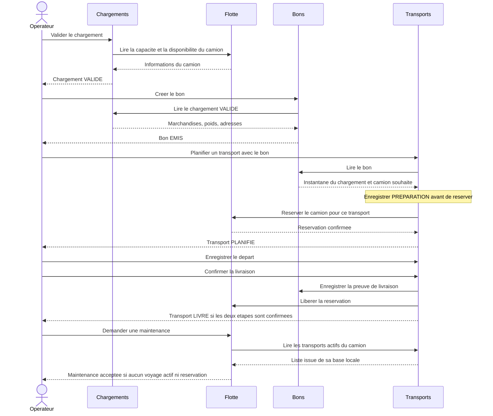

# Communication entre les backends

## Qui expose quoi, à qui ?

Toutes les routes métier commencent par `/api/v1`. Le tableau omet ce préfixe pour rester lisible.

| Fournisseur | API exposée | Consommateur | Utilité |
|---|---|---|---|
| Flotte | `GET /camions/{id}` | Chargements | Capacité et disponibilité du camion souhaité |
| Chargements | `GET /chargements/{id}` | Bons | Détail validé à copier dans le bon |
| Bons | `GET /bons/{id}` | Transports | Informations nécessaires à la planification |
| Flotte | `POST /reservations` | Transports | Attribution réelle du camion |
| Flotte | `GET /reservations?transportId=...` | Transports | Retrouver le résultat d'une réservation après une réponse perdue |
| Bons | `POST /bons/{id}/preuve-livraison` | Transports | Confirmer la réception du chargement |
| Flotte | `POST /reservations/{id}/liberation` | Transports | Rendre le camion disponible |
| Transports | `GET /transports?camionId=...&actifs=true` | Flotte | Vérifier les voyages actifs avant maintenance |

Les opérations de gestion sont aussi accessibles au frontend ou à Postman. Les fichiers [OpenAPI](../contracts/README.md) précisent leurs champs, réponses et erreurs.

## Le scénario complet



## Conventions communes

- HTTP et JSON UTF-8 ; noms de champs en `camelCase`.
- Poids en kg. Quantités entières ; poids et calculs en décimal. Un total ne vient pas d'un champ modifiable du frontend.
- Dates ISO 8601 UTC : `2026-11-10T09:00:00Z`.
- IDs sous forme de chaînes. `id` est généré par le propriétaire de la ressource.
- Listes : `page` commence à 1, `size` vaut 20 par défaut, maximum 100. Réponse `{items, page, size, total}`.
- Chaque backend expose `/health` et documente son lancement. `/health` n'est pas préfixé par `/api/v1`.
- Délais d'attente explicites pour les appels sortants, par exemple 3 secondes sur le réseau local à ajuster après test.
- Conserver et propager `X-Correlation-Id` pour suivre une action dans les journaux.

```json
{
  "code": "CAMION_INDISPONIBLE",
  "message": "Ce camion possede deja une reservation active.",
  "details": {"camionId": "CAM-001"},
  "correlationId": "demo-001"
}
```

| Code HTTP | Usage convenu |
|---|---|
| 200 | Lecture ou opération réussie |
| 201 | Ressource créée, avec un en-tête `Location` |
| 202 | Opération enregistrée, résultat distant encore en cours de confirmation |
| 204 | Suppression autorisée, sans corps de réponse |
| 400 | JSON ou paramètres mal formés |
| 404 | Ressource absente |
| 409 | État incompatible, doublon ou conflit de réservation |
| 422 | Données métier invalides, par exemple poids trop élevé |
| 503 | Dépendance temporairement indisponible avant qu'une opération distante soit engagée |

## Trois points à comprendre pendant l'intégration

### Vérifier n'est pas réserver

Chargements lit les informations du camion pour préparer le travail. Un autre transport peut le prendre ensuite. **La réservation finale chez Flotte contrôle à nouveau sa capacité et son état dans une transaction locale**, avec une contrainte d'unicité pour empêcher deux réservations actives.

### Une demande rejouée ne doit pas créer un doublon

Les POST de création de bon, transport, réservation, preuve et libération utilisent `Idempotency-Key`. Une même clé et un même corps renvoient la même ressource/opération ; une clé réutilisée avec un corps différent renvoie 409. Le résultat d'une opération en cours peut évoluer : le client retrouve son état via le GET de la ressource. Stocker l'identité de l'opération et son résultat dans la même transaction locale que son effet.

La réservation possède en plus un `transportId` unique. La preuve est rattachée à ce transport. Libérer deux fois la même réservation avec les mêmes données ne doit pas produire d'erreur métier ni de second effet.

### Une panne n'annule pas un appel déjà exécuté ailleurs

Transports conserve son étape : `PREPARATION`, `CLOTURE_EN_ATTENTE` ou `ANNULATION_EN_ATTENTE`. Une réponse perdue ne signifie pas que l'écriture distante a échoué. Il recherche le résultat puis rejoue avec la même clé si nécessaire.

Après une réservation incertaine, un GET vide ne suffit pas à conclure qu'elle n'existera jamais : résoudre la demande initiale avec la même clé avant de terminer une annulation. La clôture reste en attente tant que la preuve ET la libération ne sont pas confirmées. Voir les [états de Transports](../services/transports/README.md).

L'authentification partagée et les autorisations de service restent à choisir. Le contrat actuel décrit un socle de démonstration locale ; l'opération de preuve doit être réservée au service Transports lors de l'ajout de la sécurité.
