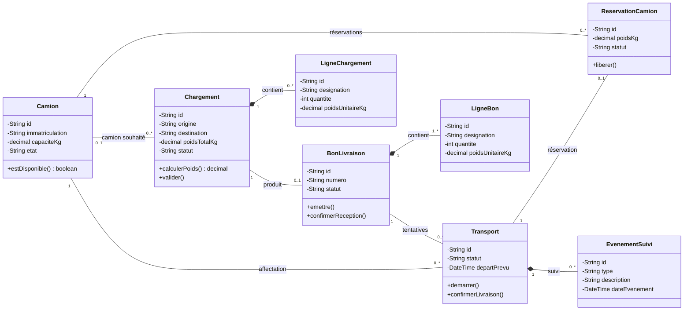

# Diagramme de classes du système

Les huit classes métier sont stockées dans **une base PostgreSQL commune**.

- `1` : exactement un ; `0..1` : facultatif ; `0..*` : plusieurs possibles ; `1..*` : au moins un.
- Le losange plein indique une composition : les lignes appartiennent à leur document.
- Un brouillon peut être vide. La validation exige au moins une ligne et un camion adapté.
- Une seule réservation active par camion et un seul transport non annulé par bon.

[Retour au projet](../README.md)
