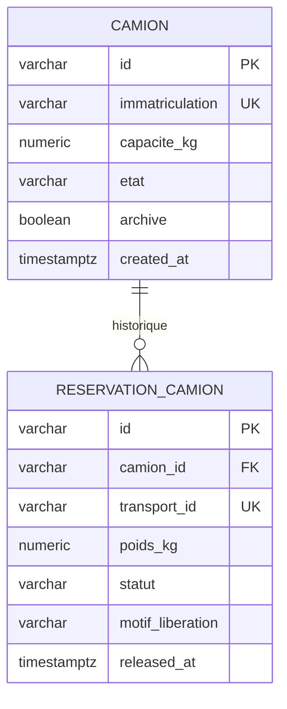
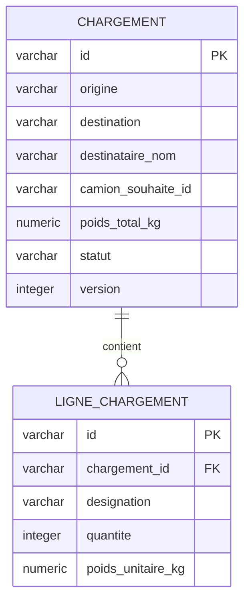
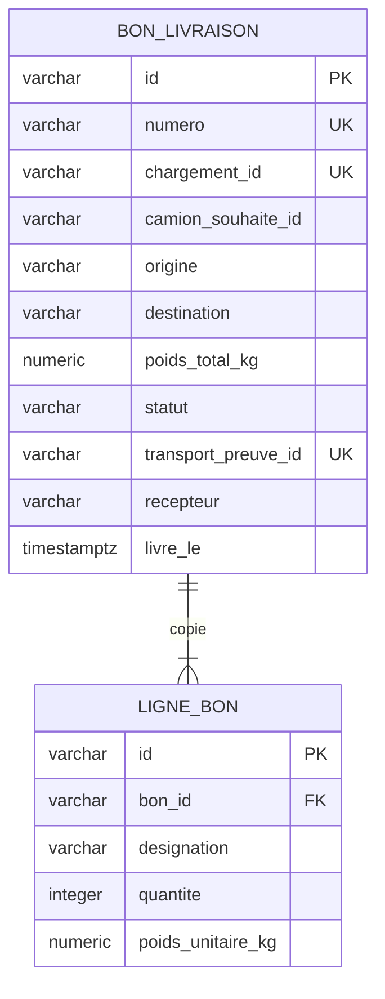
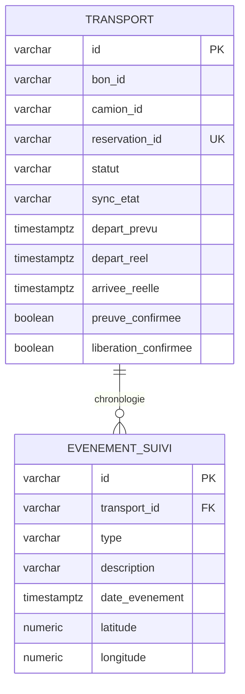

# Modèles relationnels par base

Ces quatre diagrammes montrent **les tables locales et leurs vraies clés étrangères**. Il n'y a aucune relation SQL entre les quatre bases. Les colonnes de référence externes sont annotées dans les scripts SQL.

## Base Flotte

Index unique partiel : un seul `camion_id` dont la réservation est ACTIVE. `transport_id` référence l'API Transports, sans FK locale.

## Base Chargements

Le brouillon peut être vide ; l'application exige au moins une ligne pour passer à VALIDE. `camion_souhaite_id` est une référence Flotte.

## Base Bons

L'application crée le bon et au moins une ligne ensemble. Les données des lignes et adresses sont des copies historiques. Les IDs chargement, camion et transport sont externes.

## Base Transports

Index unique partiel : un seul transport non ANNULE par `bon_id`. Bon, camion et réservation sont externes.

Ces diagrammes sélectionnent les champs métier importants. Les [scripts SQL complets](../03-modele-donnees.md) contiennent aussi les horodatages, contrôles et colonnes techniques de reprise.
