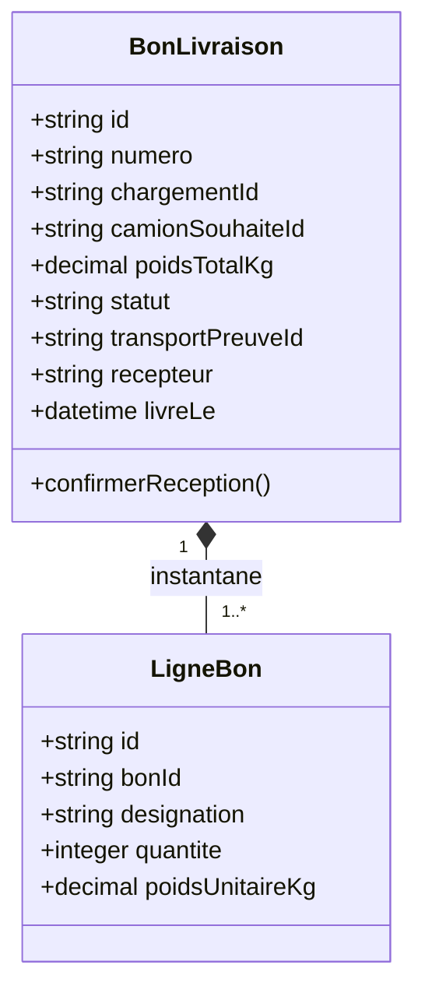

# Étudiant 3 — Bons de livraison

## En une phrase

**Je crée le document qui décrit la livraison et je conserve sa confirmation de réception.** Responsable et framework : à choisir.

| Je fournis | À qui ? | Je demande | À qui ? |
|---|---|---|---|
| Bon et instantané des marchandises | Transports | Détail d'un chargement validé | Chargements |
| Opération de confirmation de réception | Transports | Au moment de l'émission du bon | Chargements |

## Fonctions de la première version

- Émettre un bon à partir d'un chargement validé.
- Générer un numéro de document unique.
- Copier les adresses, le destinataire, les lignes, le poids et le camion souhaité.
- Consulter et rechercher les bons.
- Exposer le détail complet à Transports.
- Enregistrer une preuve de réception et passer le bon de EMIS à LIVRE.
- Accepter un rejeu identique de création ou de preuve sans doublon.

## Options à choisir ensuite

Export PDF, impression, QR code, carnet de clients, signature dessinée, photo de réception, réserves, historique d'impression, export CSV et recherche avancée. Annulation du bon, retour ou livraison partielle nécessitent des règles partagées avec Transports.

## Mes classes et données

Tables locales : `bon_livraison`, `ligne_bon`, table technique `idempotence`. [Schéma PostgreSQL](data/schema.sql). Chargement, camion et transport de preuve sont des références externes. La preuve est intégrée au bon dans le socle ; un objet Preuve séparé est une extension possible.

### Règles à respecter

- Refuser un chargement absent ou non VALIDE. Ne pas émettre un document incomplet.
- Un bon par chargement ; numéro unique, généré sans collision concurrente.
- Les données émises sont un instantané. Ne pas les relire chez Chargements à chaque consultation du bon.
- Le bon peut être consulté même si Chargements est temporairement arrêté après émission.
- Une preuve exige `transportId`, `recepteur` et `livreLe` ; commentaire facultatif.
- Même preuve rejouée : même résultat. Preuve différente ou autre transport pour un bon déjà livré : 409.
- L'opération de preuve est destinée à Transports. Elle ne rappelle pas Transports, pour éviter une boucle pendant la clôture.

## Les APIs que j'expose

Préfixe `/api/v1`. Le [contrat OpenAPI](../../contracts/bons.openapi.yaml) décrit les champs et erreurs.

| Méthode et route | Consommateur | Comportement |
|---|---|---|
| `POST /bons` | UI | Lire un chargement puis créer le bon EMIS |
| `GET /bons` | UI, Transports | Recherche par numéro, chargement, statut |
| `GET /bons/{id}` | Transports, UI | Bon avec toutes ses données copiées |
| `POST /bons/{id}/preuve-livraison` | Transports | Confirmer la réception de façon idempotente |

Expose aussi `/health`. L'export `GET /bons/{id}/pdf` pourra être ajouté si cette option est choisie ; il n'est pas inclus dans le contrat du socle.

Erreurs : 404 ressource absente ; 409 bon existant, chargement non validé ou preuve contradictoire ; 422 preuve invalide ; 503 Chargements injoignable lors de l'émission.

## L'API que je consomme

`GET /api/v1/chargements/{chargementId}` chez Chargements. Récupérer statut, origine, destination, destinataire, camion souhaité, poids et lignes. Vérifier VALIDE, puis enregistrer le bon et ses lignes dans une transaction locale.

## Mon premier scénario

Lire CHG-001 validé de 8 000 kg, créer BL-001 et montrer son détail à Transports. À la livraison, enregistrer la preuve fournie par Transports. Rejouer la même demande ne crée ni deuxième document ni deuxième preuve.

## Checklist de réalisation

- [ ] Projet, serveur et `/health`
- [ ] Appel réel vers Chargements
- [ ] Instantané et émission atomique avec numéro unique
- [ ] Détail consommable par Transports même si Chargements est arrêté
- [ ] Preuve idempotente et erreurs testées
- [ ] Contrat, Dockerfile, migrations et Compose intégrés

## Configuration proposée

`PORT=8080`, connexion Bons, `CHARGEMENTS_API_URL`. Depuis le PC : base `localhost:5435`, API prévue `localhost:8083`. Dans Compose : base `db-bons:5432`, API `bons:8080`. Ajouter les commandes du framework après sa sélection.
