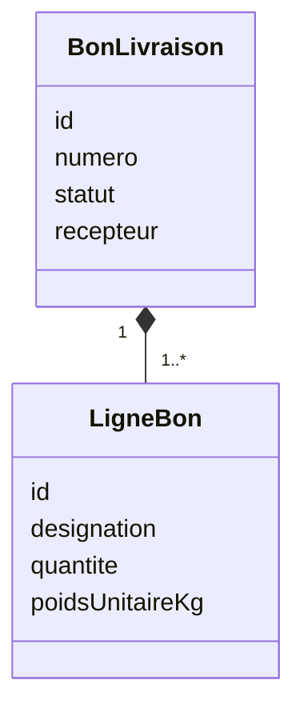

# Bons de livraison - Aitlahmous Hmad

**Spring Boot + PostgreSQL.** Je crée le document de livraison et je conserve la preuve de réception.

## Mon travail

- Émettre un bon à partir d’un chargement validé.
- Générer un numéro unique et copier les marchandises dans le bon.
- Consulter les bons et enregistrer leur confirmation de réception.

## Je communique avec qui ?

Toutes les routes commencent par `/api/v1`.

| Je fournis | À qui ? |
|---|---|
| `POST /bons` : émettre le bon | Frontend / Postman |
| `GET /bons/{id}` : détail du bon | Transports |
| `POST /bons/{id}/preuve-livraison` : confirmer la réception | Transports |

**J’appelle Chargements** : `GET /chargements/{id}` pour récupérer un chargement VALIDE.

**Règle :** un bon par chargement. Le bon garde une copie stable des lignes et des adresses.

Tables gérées : `bon_livraison`, `ligne_bon`, dans la base commune.

[Retour au projet](../../README.md)
