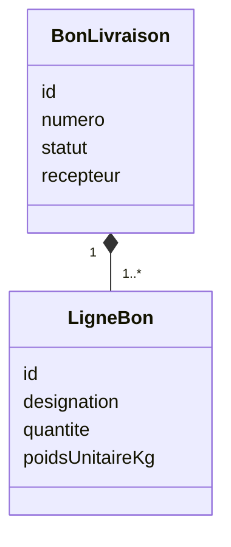

# Bons de livraison - Aitlahmous Hmad

**Spring Boot + PostgreSQL.** Je crée le document de livraison et je conserve la preuve de réception.

## Mon travail

- Émettre un bon à partir d’un chargement validé.
- Générer un numéro unique et copier les marchandises dans le bon.
- Consulter les bons et enregistrer leur confirmation de réception.



## Je communique avec qui ?

Toutes les routes commencent par `/api/v1`.

| Je fournis | À qui ? |
|---|---|
| `POST /bons` : émettre le bon | Frontend / Postman |
| `GET /bons/{id}` : détail du bon | Transports |
| `POST /bons/{id}/preuve-livraison` : confirmer la réception | Transports |

**J’appelle Chargements** : `GET /chargements/{id}` pour récupérer un chargement VALIDE.

**Règle :** un bon par chargement. Le bon garde une copie stable des lignes et des adresses.

## Contrat de preuve utilisé par Transports

`POST /api/v1/bons/{id}/preuve-livraison` reçoit :

```json
{
  "transportId": "transport-1",
  "receptionnaire": "Mohamed",
  "dateReception": "2026-11-17",
  "commentaire": "Marchandises reçues",
  "operationKey": "livraison:transport-1"
}
```

Réponse **200 OK**, y compris lors d'une répétition identique :

```json
{
  "bonId": "bon-1",
  "transportId": "transport-1",
  "receptionnaire": "Mohamed",
  "dateReception": "2026-11-17",
  "commentaire": "Marchandises reçues",
  "statut": "LIVRE"
}
```

- `transportId` : obligatoire, 64 caractères maximum ; le transport doit correspondre au bon.
- `receptionnaire` : obligatoire, non blanc, 160 caractères maximum. Conserver la valeur acceptée
  pour que la réponse corresponde à la demande de Transports.
- `dateReception` : date civile ISO `yyyy-MM-dd`, Java `LocalDate`, sans heure ni fuseau.
- `commentaire` : facultatif (`null` accepté), 1 000 caractères maximum ; le restituer à l'identique.
- `operationKey` : doit être `livraison:` suivi de `transportId` ; maximum 160 caractères.

Enregistrer la preuve et le statut LIVRE dans une même transaction, en verrouillant le bon.
Une demande répétée avec le même bon, transport et contenu renvoie la confirmation existante,
sans nouvel enregistrement. Un autre transport ou un contenu différent pour une preuve déjà
enregistrée donne **409**. Saisie invalide : **400** ; bon introuvable : **404**.

Stockage dans les colonnes existantes : `transportId` → `transport_preuve_id`,
`receptionnaire` → `recepteur`, `commentaire` → `commentaire`.
`livre_le` reste un `timestamptz` : représenter `dateReception` à **00:00 UTC**
(`dateReception.atStartOfDay().atOffset(ZoneOffset.UTC)`) et reconstruire la date en UTC
pour la réponse. Cette heure normalisée ne représente pas l'heure réelle de réception.
La contrainte unique sur `transport_preuve_id` et le bon verrouillé protègent contre les doublons ;
ne pas créer une seconde preuve pour rejouer la même opération.

Authentification : accepter le compte technique `SERVICE_TRANSPORTS` pour cet endpoint,
avec l'émetteur Keycloak commun et l'audience `bons-api`. Voir [authentification](../../auth/README.md).
Ce contrat est prêt à implémenter ; le backend Bons n'est pas encore présent dans le dépôt.

Tables gérées : `bon_livraison`, `ligne_bon`, dans la base commune.

[Retour au projet](../../README.md)
