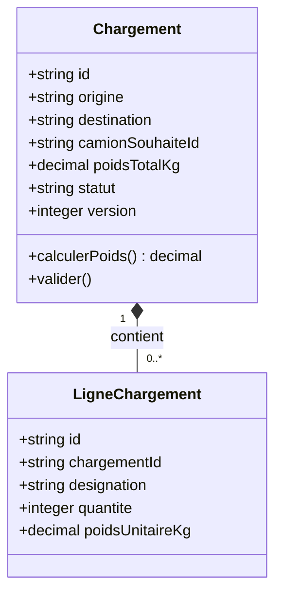

# Étudiant 2 — Chargements

## En une phrase

**Je prépare les marchandises à transporter, leur poids, leurs adresses et le camion souhaité.** Responsable et framework : à choisir.

| Je fournis | À qui ? | Je demande | À qui ? |
|---|---|---|---|
| Détail du chargement validé et ses lignes | Bons | Capacité et disponibilité du camion | Flotte |

## Fonctions de la première version

- Créer, consulter et modifier un chargement en brouillon.
- Saisir origine, destination, destinataire et camion souhaité.
- Ajouter/modifier/retirer des lignes de marchandises.
- Calculer le poids total avec quantité × poids unitaire.
- Contrôler le camion via Flotte avant validation.
- Valider le chargement et le rendre immuable.
- Fournir à Bons un détail complet qui ne nécessite pas d'accès à ma base.

## Options à choisir ensuite

Catégories de marchandises, volume, palettes, dimensions, dates souhaitées, priorité, conditions de transport, photos, export CSV, duplication vers un nouveau brouillon et lecture de codes-barres. Groupage et multiples destinations sont des évolutions collectives.

## Mes classes et données

Tables locales : `chargement`, `ligne_chargement`, table technique `idempotence`. [Schéma PostgreSQL](data/schema.sql). Le camion souhaité est une référence externe, pas une FK SQL vers Flotte.

### Règles à respecter

- Le brouillon peut être incomplet et n'avoir aucune ligne.
- Pour valider : adresses et nom du destinataire renseignés, camion souhaité renseigné, au moins une ligne, quantité entière et poids unitaire positifs.
- Poids calculé côté serveur, en décimal. Recalculer après chaque changement de ligne dans la même transaction locale.
- Flotte doit confirmer un camion en service, non archivé, disponible et de capacité suffisante.
- Cette consultation **ne réserve pas** le camion. La réservation finale appartient à Flotte lors de la planification par Transports.
- Le chargement VALIDE n'est plus modifiable ni supprimable. Pour corriger, créer un autre brouillon.
- Pendant la validation distante, conserver une version ; après la réponse, ne valider que si aucune modification concurrente n'a eu lieu. Sinon retourner 409.

## Les APIs que j'expose

Préfixe `/api/v1`. Le [contrat OpenAPI](../../contracts/chargements.openapi.yaml) décrit les formats.

| Méthode et route | Consommateur | Comportement |
|---|---|---|
| `GET /chargements` | UI | Liste filtrée par statut et destination |
| `POST /chargements` | UI | Créer un BROUILLON |
| `GET /chargements/{id}` | Bons, UI | Détail complet, lignes et poids |
| `PATCH /chargements/{id}` | UI | Modifier un brouillon |
| `DELETE /chargements/{id}` | UI | Supprimer un brouillon seulement |
| `POST /chargements/{id}/lignes` | UI | Ajouter une ligne et recalculer |
| `PATCH /chargements/{id}/lignes/{ligneId}` | UI | Modifier une ligne du bon chargement |
| `DELETE /chargements/{id}/lignes/{ligneId}` | UI | Retirer une ligne du brouillon |
| `POST /chargements/{id}/validation` | UI | Appeler Flotte, vérifier la version puis valider |

Expose aussi `/health`. La lecture d'un détail consulte la base locale, sans rappeler Flotte. Erreurs : 404 absent ; 409 chargement immuable, camion indisponible ou version changée ; 422 données invalides/surcharge ; 503 Flotte injoignable.

## L'API que je consomme

`GET /api/v1/camions/{camionSouhaiteId}` chez Flotte, pendant la validation. Utiliser `capaciteKg`, `etat`, `archive`, `disponible`. Distinguer un vrai 404 d'une panne réseau.

## Mon premier scénario

Créer 160 sacs de 50 kg : total 8 000 kg. Valider avec CAM-001 de capacité 10 000 kg. Bons récupère les lignes pour son document. Avec un camion de 5 000 kg, la validation est refusée.

## Checklist de réalisation

- [ ] Projet, serveur et `/health`
- [ ] Chargement et lignes avec calcul de poids
- [ ] Validation des données et immutabilité du validé
- [ ] Appel réel vers Flotte et gestion des erreurs
- [ ] Modification concurrente pendant validation traitée
- [ ] Lecture réelle consommée par Bons
- [ ] Contrat, Dockerfile, migrations et Compose intégrés

## Configuration proposée

`PORT=8080`, connexion Chargements, `FLOTTE_API_URL`. Depuis le PC : base `localhost:5434`, API prévue `localhost:8082`. Dans Compose : base `db-chargements:5432`, API `chargements:8080`. Ajouter ici les commandes du framework une fois choisi.
