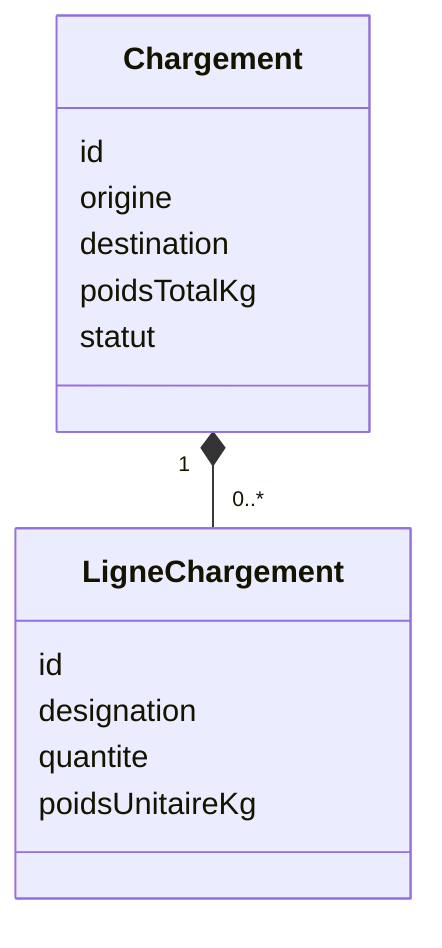

# Chargements - Sina Oussama

**Spring Boot + PostgreSQL.** Je prépare les marchandises et je valide le chargement.

## Mon travail

- Créer un brouillon avec origine, destination et destinataire.
- Ajouter les lignes : désignation, quantité et poids unitaire.
- Calculer le poids total et valider avec un camion adapté.

## Je communique avec qui ?

Toutes les routes commencent par `/api/v1`. Le frontend ou Postman utilise aussi mes routes de gestion.

| Je fournis | À qui ? |
|---|---|
| `POST /chargements` : créer le brouillon | Frontend / Postman |
| `POST /chargements/{id}/validation` : valider | Frontend / Postman |
| `GET /chargements/{id}` : détail et lignes du chargement | Bons de livraison |

**J’appelle Camions** : `GET /camions/{id}` pour vérifier capacité, état et disponibilité.

**Règle :** poids total = somme des quantités × poids unitaires. Un chargement VALIDE ne se modifie plus.
La validation ne réserve pas le camion ; Transports le réservera lors de la planification.

Tables gérées : `chargement`, `ligne_chargement`, dans la base commune.

[Retour au projet](../../README.md)
