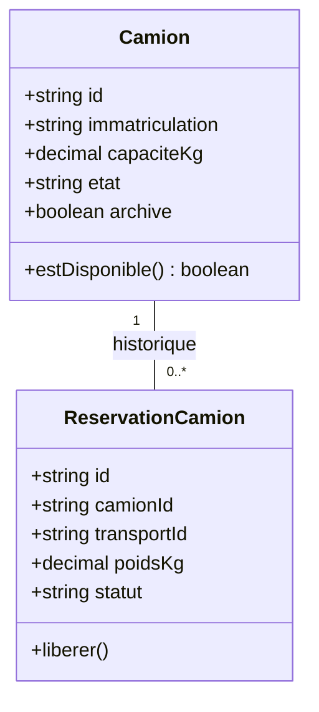

# Étudiant 1 — Flotte / Camions

## En une phrase

**Je gère les camions et je sais lesquels peuvent être utilisés pour un transport.** Responsable et framework : à choisir.

| Je fournis | À qui ? | Je demande | À qui ? |
|---|---|---|---|
| Capacité et disponibilité | Chargements | Transports actifs d'un camion | Transports |
| Réservation et libération du camion | Transports | Cette lecture se fait avant une maintenance | Transports |

## Fonctions de la première version

- Ajouter, consulter, rechercher et modifier un camion.
- Enregistrer immatriculation, capacité en kg et état opérationnel.
- Calculer la disponibilité, afficher les camions disponibles.
- Archiver un camion pour conserver son historique.
- Réserver un camion pour un transport et libérer sa réservation.
- Refuser une double réservation ou un poids excessif.
- Mettre en maintenance seulement après contrôle des voyages actifs et réservations ; remettre en service après intervention.

## Options à choisir ensuite

Chauffeurs, entretien préventif, historique des maintenances, kilométrage, documents du véhicule, catégories de camions, volume, carburant et statistiques. Les réservations par créneaux futurs demandent un autre contrôle de chevauchement et ne font pas partie du socle.

## Mes classes et données

Tables locales : `camion`, `reservation_camion` et table technique `idempotence`. [Schéma PostgreSQL](data/schema.sql). `transportId` est externe : aucune FK SQL vers la base Transports.

### Règles à respecter

- Immatriculation unique après normalisation ; capacité strictement positive.
- États du socle : `EN_SERVICE`, `MAINTENANCE` ; archivage séparé.
- Disponible = en service + non archivé + aucune réservation `ACTIVE`.
- Une réservation ACTIVE maximum par camion ; une réservation par `transportId`.
- Verrouiller le camion et créer la réservation dans une transaction locale. Ajouter une contrainte SQL d'unicité pour la concurrence.
- Les mises en maintenance, changements de capacité et archivages utilisent le même verrou. Refuser les changements incompatibles avec une réservation active.
- Avant maintenance, appeler Transports puis refaire le contrôle local sous verrou. Si l'API est indisponible, refuser temporairement plutôt que supposer qu'aucun voyage n'existe.

## Les APIs que j'expose

Préfixe `/api/v1` ; UI signifie frontend ou Postman. Le [contrat OpenAPI](../../contracts/flotte.openapi.yaml) contient les champs et erreurs.

| Méthode et route | Consommateur | Comportement |
|---|---|---|
| `GET /camions` | UI, Chargements | Liste filtrée et paginée |
| `POST /camions` | UI | Créer un camion |
| `GET /camions/{id}` | Chargements, UI | Capacité, état, archivage et disponibilité |
| `PATCH /camions/{id}` | UI | Modifier les champs autorisés |
| `POST /camions/{id}/archivage` | UI | Archiver si aucune réservation active |
| `POST /camions/{id}/maintenance` | UI | Contrôler Transports puis l'état local |
| `POST /camions/{id}/remise-service` | UI | Repasser en service |
| `POST /reservations` | Transports | Contrôler et réserver atomiquement |
| `GET /reservations` | Transports, UI | Filtres `transportId`, `camionId`, `statut` |
| `GET /reservations/{id}` | Transports, UI | Lire une réservation |
| `POST /reservations/{id}/liberation` | Transports | Libérer de façon idempotente |

Expose aussi `/health`. Erreurs principales : 404 ressource absente ; 409 camion occupé ou changement interdit ; 422 poids excessif ; 503 Transports injoignable avant maintenance.

## L'API que je consomme

`GET /api/v1/transports?camionId=CAM-001&actifs=true&size=1` chez Transports. Lire `total`, pas seulement la première page. Cette opération distante ne rappelle jamais Flotte ; elle lit uniquement sa base locale.

## Mon premier scénario

Créer CAM-001, capacité 10 000 kg. Chargements le consulte. Transports réserve 8 000 kg ; un autre transport ne peut plus le réserver. Une demande de maintenance est refusée pendant le voyage. Après libération, la maintenance devient possible.

## Checklist de réalisation

- [ ] Projet et framework choisis ; serveur et `/health` démarrés
- [ ] Modèles, migrations, CRUD et filtres opérationnels
- [ ] Disponibilité calculée correctement
- [ ] Appel réel vers Transports pour la maintenance
- [ ] Réservation concurrente et libération idempotente testées
- [ ] Contrat et exemples conformes aux réponses réelles
- [ ] Dockerfile et intégration Compose ajoutés

## Configuration proposée

`PORT=8080`, connexion locale Flotte, `TRANSPORTS_API_URL`. Depuis le PC : base `localhost:5433`, API prévue `localhost:8081`. Dans Compose : base `db-flotte:5432`, API `flotte:8080`.

Le Dockerfile et le code ne sont pas encore présents. Ajouter le choix de framework et ses commandes de lancement dans ce guide dès le début du développement.
