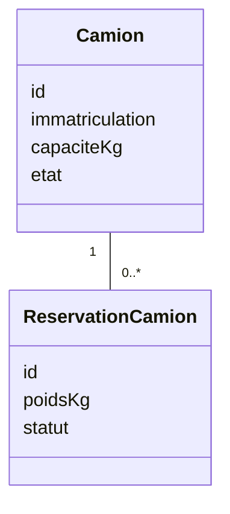

# Camions - Ibnahmad Hassan

**Spring Boot + PostgreSQL.** Je gère les véhicules, leur capacité et leurs réservations.

L'API est exécutable et compatible avec Chargements. L'authentification Keycloak commune reste
à intégrer dans ce backend : voir [auth/README.md](../../auth/README.md).
Les actions de maintenance et d'archivage ne sont pas encore exposées par les routes actuelles.

## Mon travail

- Ajouter, consulter et modifier un camion.
- Gérer la disponibilité, la maintenance et la remise en service.
- Réserver ou libérer un camion pour un transport.



## Je communique avec qui ?

Toutes les routes commencent par `/api/v1`. Le frontend ou Postman utilise aussi mes routes de gestion.

| Je fournis | À qui ? |
|---|---|
| `GET /camions/{id}` : capacité, état, disponibilité | Chargements |
| `POST /reservations` : réserver le camion | Transports |
| `GET /reservations?transportId=...` : retrouver une réservation | Transports |
| `POST /reservations/{id}/liberation` : libérer le camion | Transports |

**J’appelle Transports** : `GET /transports?camionId=...&actifs=true` avant une maintenance.

Pour Chargements, `GET /camions/{id}` renvoie `id`, `capaciteKg`, `etat`, `archive`
et `disponible` (calculé à partir des réservations actives).
Voir [le contrat et l’exemple JSON](../chargements/README.md#api-consommée--camions).

**Règle :** un seul transport peut réserver un camion à la fois. Refuser la maintenance si un voyage est actif.

Tables gérées : `camion`, `reservation_camion`, dans la base commune.

[Retour au projet](../../README.md)

## Initialisation Spring Boot

Le projet utilise Java 21, Maven et Spring Boot. Les endpoints implémentés
incluent `GET /health`, `POST /api/v1/camions` et `GET /api/v1/camions/{id}`.
Le health check vérifie qu'une connexion JDBC à PostgreSQL (Neon) peut être
obtenue et répond `{"status":"ok"}` ou HTTP 503.

### Configuration Neon

L'URL, le nom d'utilisateur et le mot de passe JDBC sont lus par Spring Boot
depuis les variables standard `SPRING_DATASOURCE_URL`,
`SPRING_DATASOURCE_USERNAME` et `SPRING_DATASOURCE_PASSWORD`. Ces variables
figurent déjà dans le `.env` local à la racine du dépôt. Spring Boot et IntelliJ
ne chargent pas automatiquement ce fichier : il faut renseigner les variables
dans la configuration Run de l'IDE.

Le schéma Hibernate est fixé à `public`, `ddl-auto` à `validate` et
`spring.sql.init.mode` à `never`. L'application vérifie donc le schéma existant
sans créer ni modifier les tables. Les variables de pool
`SPRING_DATASOURCE_HIKARI_*` peuvent également être renseignées dans IntelliJ
si elles figurent dans votre `.env`.

### Ouvrir et lancer dans IntelliJ IDEA

1. Dans IntelliJ, choisir **File > Open** et sélectionner
   `services/flotte/pom.xml`. Choisir **Open as Project** si demandé, puis
   attendre l'import Maven.
2. Dans **File > Project Structure**, sélectionner un JDK 21 pour le Project
   SDK et le Project language level. Dans les paramètres Maven, utiliser
   également un JDK 21 pour l'importateur Maven et le runner.
3. Ouvrir `src/main/java/ma/transport/flotte/FlotteApplication.java` et cliquer
   sur l'icône **Run** à côté de la méthode `main`, ou créer une configuration
   **Application** avec cette classe comme Main class et `services/flotte`
   comme Working directory.
4. Dans **Run > Edit Configurations**, renseigner l'environnement dans
   **Environment variables** :
   `SPRING_DATASOURCE_URL`, `SPRING_DATASOURCE_USERNAME` et
   `SPRING_DATASOURCE_PASSWORD`, avec les valeurs correspondantes du `.env`
   local. Ajouter aussi `SPRING_JPA_HIBERNATE_DDL_AUTO=validate` et
   `SPRING_SQL_INIT_MODE=never` si ces variables sont présentes dans `.env`.
   Saisir les valeurs localement dans l'IDE ; ne pas les copier dans un fichier
   de configuration Run partagé ou versionné.
5. Cliquer sur **Run**. Le serveur écoute sur le port `8081`.

Tester la connexion à Neon avec `GET http://localhost:8081/health`. En cas de
connexion valide, la réponse est HTTP 200 avec `{"status":"ok"}`.

### Compilation

Depuis `services/flotte` :

```powershell
mvn test
```

## Camions implémentés

Les entités sont mappées sur `public.camion` et `public.reservation_camion` de
la base commune. Le schéma est validé par Hibernate (`ddl-auto=validate`), sans
création ni modification automatique des tables.

### Créer un camion

`POST http://localhost:8081/api/v1/camions`

En-tête : `Content-Type: application/json`

Corps :

```json
{
  "immatriculation": " 12345   a-1 ",
  "capaciteKg": 10000
}
```

La réponse est `201 Created`, avec un en-tête `Location` pointant sur le camion
et un corps comme :

```json
{
  "id": "4ed6f415-530d-44c9-afeb-a08b435ff4a0",
  "immatriculation": "12345 A-1",
  "capaciteKg": 10000,
  "etat": "EN_SERVICE",
  "archive": false,
  "disponible": true,
  "createdAt": "2026-11-07T00:00:00Z"
}
```

L'immatriculation est nettoyée des espaces aux extrémités, ses espaces
consécutifs sont réduits à un seul, puis elle est convertie en majuscules. Le
contrôle du doublon applique la même normalisation aux immatriculations déjà
présentes en base.
Une immatriculation déjà utilisée répond `409 Conflict`. Une immatriculation
vide ou trop longue, une capacité absente, nulle ou négative, ainsi qu'un corps
absent ou illisible répondent `422 Unprocessable Entity`.

### Consulter un camion

`GET http://localhost:8081/api/v1/camions/{id}`

Une ressource présente répond `200 OK` avec le même format JSON que ci-dessus.
`disponible` vaut true seulement si le camion est `EN_SERVICE`, n'est pas
archivé et ne possède aucune réservation `ACTIVE`. Un identifiant absent
répond `404 Not Found`.

### Santé

`GET http://localhost:8081/health` vérifie la connexion à la base Neon et
répond `200 OK` avec `{"status":"ok"}` ou `503 Service Unavailable` si la base
est inaccessible.

## Réservations

### Créer ou retrouver une réservation

`POST http://localhost:8081/api/v1/reservations`

```json
{
  "camionId": "4ed6f415-530d-44c9-afeb-a08b435ff4a0",
  "transportId": "1fa5d819-5213-4f7b-ad3b-7296992e97db",
  "poidsKg": 8000
}
```

Le transport doit déjà exister dans la base commune. Le compte Camions ne lit
pas `public.transport` : PostgreSQL vérifie la clé étrangère lors de
l'insertion. Un transport inexistant donne `422 Unprocessable Entity` avec le
code `TRANSPORT_NOT_FOUND`, sans exposer de détail SQL.

Une nouvelle réservation donne `201 Created`, avec un en-tête `Location` et
une réponse au format suivant :

```json
{
  "id": "6f762234-2b9a-4a2d-b1ef-31f68df64136",
  "camionId": "4ed6f415-530d-44c9-afeb-a08b435ff4a0",
  "transportId": "1fa5d819-5213-4f7b-ad3b-7296992e97db",
  "poidsKg": 8000,
  "statut": "ACTIVE",
  "motifLiberation": null,
  "createdAt": "2026-11-07T01:00:00Z",
  "releasedAt": null
}
```

Le camion est verrouillé pendant l'opération. Il doit exister, être
`EN_SERVICE`, non archivé, sans réservation `ACTIVE`, et avoir une capacité
suffisante. Un camion absent répond `404`; un camion indisponible répond `409`;
un poids absent, non positif ou supérieur à la capacité répond `422`.

Répéter la création avec le même `transportId`, `camionId` et `poidsKg`
retourne la réservation existante sans en créer une autre. Si les données
diffèrent, la réponse est `409 Conflict`. L'index unique actif par camion
protège également contre les créations concurrentes.

Les erreurs reprennent le format API avec `code`, `message`, `details` et
`correlationId`. Par exemple, pour un transport qui n'existe pas :

```json
{
  "code": "TRANSPORT_NOT_FOUND",
  "message": "Le transport reference n'existe pas.",
  "details": {},
  "correlationId": "c0e8c1e3-7c76-458a-a77e-550cc3bf8a8b"
}
```

Les codes principaux sont `NOT_FOUND` (404), `CAMION_UNAVAILABLE` et
`RESERVATION_CONFLICT` (409), puis `VALIDATION_ERROR`, `CAPACITY_EXCEEDED` et
`TRANSPORT_NOT_FOUND` (422).

### Consulter une réservation

- `GET http://localhost:8081/api/v1/reservations/{id}` recherche par ID de
  réservation.
- `GET http://localhost:8081/api/v1/reservations?transportId={transportId}`
  recherche par ID de transport.

Les deux routes renvoient `200 OK` et le format JSON complet de réservation
illustré ci-dessus. Si aucune réservation ne correspond à l'identifiant donné,
elles renvoient `404 Not Found` avec le format d'erreur API.

### Libérer une réservation

`POST http://localhost:8081/api/v1/reservations/{id}/liberation`

```json
{
  "motif": "LIVRAISON"
}
```

Les seules valeurs autorisées sont `LIVRAISON` et `ANNULATION`. La réponse
`200 OK` reprend le format de réservation avec `statut: "LIBEREE"`,
`motifLiberation` égal au motif reçu et `releasedAt` renseigné. Une répétition
avec le même motif retourne la réservation sans changer sa date de libération;
un motif différent donne `409 Conflict`. Une réservation inconnue répond `404`
et un motif absent ou invalide répond `422`.

Les horodatages sont produits en UTC avec une précision à la microseconde, compatible avec
PostgreSQL. La première réponse et une répétition après relecture en base conservent ainsi
les mêmes dates de création et de libération.

Les opérations réservent et libèrent en verrouillant d'abord la ligne camion,
puis la réservation, dans cet ordre. La modification de capacité utilise le
même verrou camion. Aucune table commune ni migration n'est modifiée.

### Tests de réservation

`mvn test` lance aussi les tests d'intégration PostgreSQL Testcontainers,
lorsque Docker est disponible. Si Docker n'est pas disponible, ils sont
également exécutables contre une base PostgreSQL isolée avec les variables
locales `FLOTTE_TEST_DATABASE_URL`, `FLOTTE_TEST_DATABASE_USERNAME` et
`FLOTTE_TEST_DATABASE_PASSWORD`. Par sécurité, cette URL doit viser
`localhost`, `127.0.0.1` ou `::1` et une base dédiée nommée `flotte_test`;
les tests refusent les autres hôtes, dont Neon. La base éphémère contient les tables et
contraintes nécessaires aux camions, réservations, transports de test, à la FK
de transport et à l'index des réservations actives; elle est séparée de Neon.

## Liste et modification des camions

### Lister avec pagination et disponibilité

`GET http://localhost:8081/api/v1/camions?page=0&size=20&disponible=true`

`page` commence à `0` (valeur par défaut : `0`), `size` est compris entre `1`
et `100` (valeur par défaut : `20`). Le filtre `disponible` est facultatif ;
il accepte `true` ou `false`. Le filtre est appliqué en base avant la
pagination et le total décrit les camions satisfaisant ce filtre.

Exemple de réponse `200 OK` :

```json
{
  "items": [
    {
      "id": "4ed6f415-530d-44c9-afeb-a08b435ff4a0",
      "immatriculation": "12345 A-1",
      "capaciteKg": 10000,
      "etat": "EN_SERVICE",
      "archive": false,
      "disponible": true,
      "createdAt": "2026-11-07T00:00:00Z"
    }
  ],
  "page": 0,
  "size": 20,
  "totalElements": 1,
  "totalPages": 1
}
```

### Modifier partiellement un camion

`PATCH http://localhost:8081/api/v1/camions/{id}`

Envoyer un ou les deux champs modifiables. Les champs absents restent
inchangés ; une valeur `null`, un objet vide, ou un champ non modifiable
(`etat`, `archive`, etc.) est refusé avec `422 Unprocessable Entity`.

Exemple pour modifier seulement l'immatriculation :

```json
{
  "immatriculation": " 67890   b-2 "
}
```

Réponse `200 OK` : représentation complète du camion mis à jour, par exemple
avec `immatriculation` égal à `"67890 B-2"` ; les autres propriétés,
notamment `capaciteKg`, sont conservées.

Exemple pour modifier seulement la capacité :

```json
{
  "capaciteKg": 12000
}
```

Le camion est verrouillé pendant la transaction. Avant une modification de
capacité, le service lit les réservations `ACTIVE` et répond `409 Conflict` si
la nouvelle capacité est inférieure au poids réservé. Une immatriculation
normalisée déjà utilisée répond également `409`. Un identifiant introuvable
répond `404`; les valeurs nulles, vides ou invalides répondent `422`.
