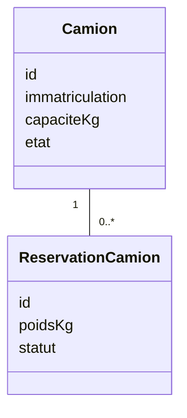

# Camions - Ibnahmad Hassan

**Spring Boot + PostgreSQL.** Je gère les véhicules, leur capacité et leurs réservations.

## Mon travail

- Ajouter, consulter et modifier un camion.
- Gérer la disponibilité, la maintenance et la remise en service.
- Réserver ou libérer un camion pour un transport.

## Je communique avec qui ?

Toutes les routes commencent par `/api/v1`. Le frontend ou Postman utilise aussi mes routes de gestion.

| Je fournis | À qui ? |
|---|---|
| `GET /camions/{id}` : capacité, état, disponibilité | Chargements |
| `POST /reservations` : réserver le camion | Transports |
| `GET /reservations?transportId=...` : retrouver une réservation | Transports |
| `POST /reservations/{id}/liberation` : libérer le camion | Transports |

**J’appelle Transports** : `GET /transports?camionId=...&actifs=true` avant une maintenance.

Pour Chargements, `GET /camions/{id}` renvoie `id`, `capaciteKg`, `etat`, `archive`
et `disponible` (calculé à partir des réservations actives).
Voir [le contrat et l’exemple JSON](../chargements/README.md#api-consommée--camions).

**Règle :** un seul transport peut réserver un camion à la fois. Refuser la maintenance si un voyage est actif.

Tables gérées : `camion`, `reservation_camion`, dans la base commune.

[Retour au projet](../../README.md)
