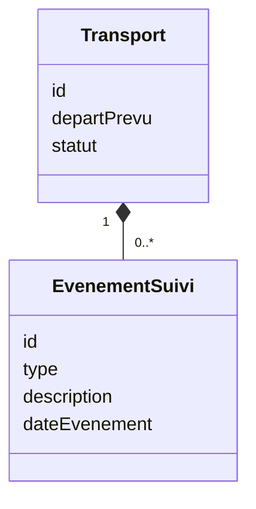

# Transports / Suivi - Chammakh Ayoub

**Spring Boot + PostgreSQL.** Je planifie le voyage et je suis la livraison.

## Mon travail

- Planifier à partir d’un bon et réserver le camion.
- Enregistrer le départ, les pointages et l’arrivée.
- Confirmer la livraison ou annuler avant le départ, puis libérer le camion.

## Je communique avec qui ?

Toutes les routes commencent par `/api/v1`.

| Je fournis | À qui ? |
|---|---|
| `POST /transports` : planifier | Frontend / Postman |
| `POST /transports/{id}/depart` : déclarer le départ | Frontend / Postman |
| `POST /transports/{id}/evenements` : ajouter un pointage | Frontend / Postman |
| `POST /transports/{id}/livraison` : confirmer l’arrivée | Frontend / Postman |
| `POST /transports/{id}/annulation` : annuler avant départ | Frontend / Postman |
| `GET /transports?camionId=...&actifs=true` : voyages actifs | Camions |

**J’appelle Bons** : `GET /bons/{id}` puis `POST /bons/{id}/preuve-livraison` à la réception.
**J’appelle Camions** : `POST /reservations` puis `POST /reservations/{id}/liberation`.
Si une confirmation manque, retrouver la réservation avec `GET /reservations?transportId=...` et reprendre sans doublon.

**Règle :** départ après réservation confirmée ; statut LIVRE après preuve et libération confirmées.

Tables gérées : `transport`, `evenement_suivi`, dans la base commune.

**Schéma :** V1 puis [V2 (preuve et reprise)](../../database/V2__transport_preuve_reprise.sql),
déjà appliquées sur Neon. V2 conserve le réceptionnaire, la date et le commentaire avant l'appel à Bons.
Le [contrat Bons](../bons/README.md#confirmer-la-livraison) définit les champs
`dateReception` (date ISO sans heure), `operationKey` et la réponse attendue en cas de répétition.

## Authentification

Transports utilise le realm Keycloak commun `transport-ws`.
Voir [la documentation d'authentification](../../auth/README.md)
pour démarrer Keycloak et obtenir un token avec Postman.

- `ADMIN` et `AGENT` peuvent consulter et effectuer les opérations métier.
- `LECTEUR` peut consulter uniquement.
- Le compte technique Camions peut consulter les transports actifs
  d'un camion avec les filtres `camionId` et `actifs=true`.

Pour ses appels vers Bons et Camions, Transports utilise le compte technique
`transports-service`. Son secret est fourni par la variable d'environnement
`TRANSPORTS_CLIENT_SECRET` ; il ne doit pas être enregistré dans Git.

Pour les tests entre plusieurs machines, l'équipe doit utiliser une instance
Keycloak commune accessible à tous.

## Vérification

Lancer `mvn test` depuis `services/transports`. Ces tests ne remplacent pas
un test complet avec les services Bons et Camions et la base de test partagée.

[Retour au projet](../../README.md)
