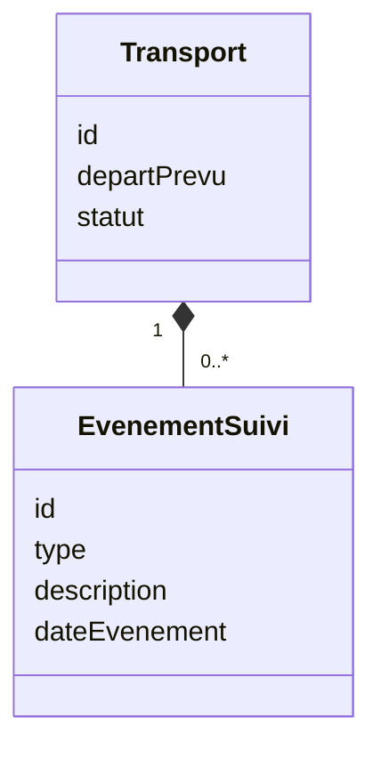

# Transports / Suivi - Chammakh Ayoub

**Spring Boot + PostgreSQL.** Je planifie le voyage et je suis la livraison.

## Mon travail

- Planifier à partir d’un bon et réserver le camion.
- Enregistrer le départ, les pointages et l’arrivée.
- Confirmer la livraison ou annuler avant le départ, puis libérer le camion.

## Je communique avec qui ?

Toutes les routes commencent par `/api/v1`.

| Je fournis | À qui ? |
|---|---|
| `POST /transports` : planifier | Frontend / Postman |
| `POST /transports/{id}/depart` : déclarer le départ | Frontend / Postman |
| `POST /transports/{id}/evenements` : ajouter un pointage | Frontend / Postman |
| `POST /transports/{id}/livraison` : confirmer l’arrivée | Frontend / Postman |
| `POST /transports/{id}/annulation` : annuler avant départ | Frontend / Postman |
| `GET /transports?camionId=...&actifs=true` : voyages actifs | Camions |

**J’appelle Bons** : `GET /bons/{id}` puis `POST /bons/{id}/preuve-livraison` à la réception.
**J’appelle Camions** : `POST /reservations` puis `POST /reservations/{id}/liberation`.
Si une confirmation manque, retrouver la réservation avec `GET /reservations?transportId=...` et reprendre sans doublon.

**Règle :** départ après réservation confirmée ; statut LIVRE après preuve et libération confirmées.

Tables gérées : `transport`, `evenement_suivi`, dans la base commune.

[Retour au projet](../../README.md)
