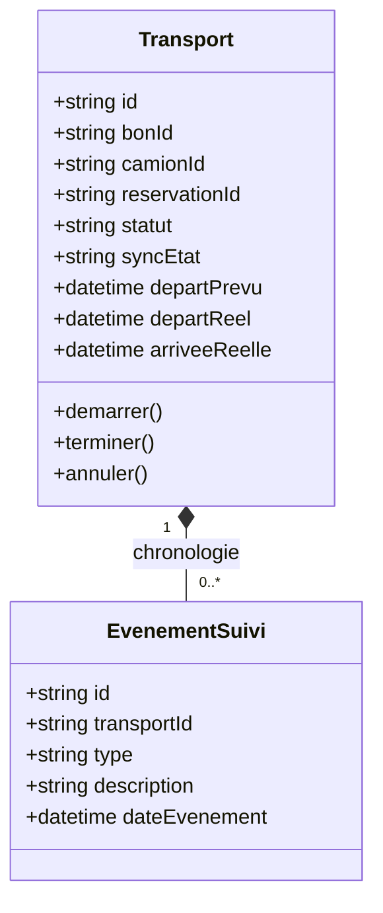
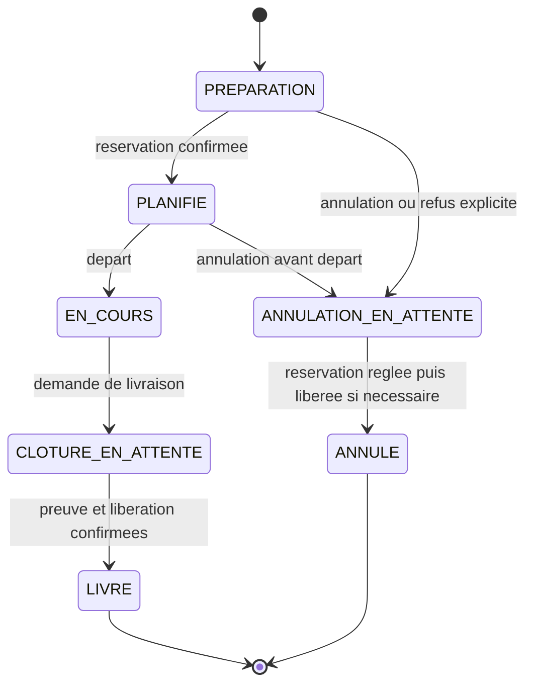

# Étudiant 4 — Transports / Suivi

## En une phrase

**J'organise le voyage à partir d'un bon et d'un camion, puis je suis son départ et sa livraison.** Responsable et framework : à choisir.

| Je fournis | À qui ? | Je demande | À qui ? |
|---|---|---|---|
| Voyages actifs d'un camion | Flotte | Détail du bon et enregistrement de preuve | Bons |
| États et chronologie du transport | UI | Réservation et libération du camion | Flotte |

## Fonctions de la première version

- Planifier un transport à partir d'un bon EMIS.
- Utiliser le camion souhaité et le poids du bon ; réserver ce camion chez Flotte.
- Passer à PLANIFIE après confirmation de réservation.
- Enregistrer le départ et les événements du voyage.
- Confirmer la livraison avec le réceptionnaire et la date.
- Déposer la preuve chez Bons puis libérer le camion chez Flotte.
- Annuler avant le départ et libérer toute réservation existante.
- Fournir à Flotte la liste des voyages actifs d'un camion.
- Reprendre les opérations inachevées sans doublon après une panne.

## Options à choisir ensuite

Incidents, retard, saisie manuelle de position, carte, GPS simulé ou réel, estimation d'arrivée, chauffeur, statistiques et notifications. Commencer avec des événements manuels. Réaffectation de camion et tournées demandent des contrats supplémentaires.

## Mes classes et données

Tables locales : `transport`, `evenement_suivi`, table technique `idempotence`. [Schéma PostgreSQL](data/schema.sql). Bon, camion et réservation restent des références externes.

## Les états

`actifs=true` exclut **seulement LIVRE et ANNULE**. Une opération en attente est encore active. `syncEtat` vaut `OK` ou `A_REPRENDRE` et indique si une confirmation distante manque.

## Les APIs que j'expose

Préfixe `/api/v1` ; [contrat complet](../../contracts/transports.openapi.yaml).

| Méthode et route | Consommateur | Comportement |
|---|---|---|
| `POST /transports` | UI | Lire le bon et réserver ; 201 PLANIFIE ou 202 PREPARATION |
| `GET /transports` | Flotte, UI | Liste locale ; filtres camion, bon, statut et actifs |
| `GET /transports/{id}` | UI | Détail, état et synchronisation |
| `POST /transports/{id}/depart` | UI | PLANIFIE vers EN_COURS |
| `GET /transports/{id}/evenements` | UI | Chronologie paginée |
| `POST /transports/{id}/evenements` | UI | Pointage ou commentaire manuel |
| `POST /transports/{id}/livraison` | UI | Confirmer preuve et libération ; 200 ou 202 |
| `POST /transports/{id}/annulation` | UI | Avant départ ; 200 ou 202 |
| `POST /transports/{id}/reconciliation` | UI interne | Reprendre les étapes manquantes |

Expose aussi `/health`. Ne pas permettre un PATCH libre du statut. Les événements DEPART et ARRIVEE sont produits par les opérations métier correspondantes ; l'ajout manuel ne contourne pas les transitions.

## Les APIs que je consomme

- Bons : `GET /api/v1/bons/{id}` ; le bon doit être EMIS. Il contient les adresses, le poids et le camion souhaité.
- Flotte : `POST /api/v1/reservations` avec `camionId`, `transportId`, `poidsKg`.
- Flotte : `GET /api/v1/reservations?transportId=...` pour retrouver une demande incertaine.
- Bons : `POST /api/v1/bons/{id}/preuve-livraison` à la clôture.
- Flotte : `POST /api/v1/reservations/{id}/liberation` après livraison ou annulation.

## Règles de préparation et de reprise

Enregistrer l'intention PREPARATION **avant** d'envoyer la réservation. Contrainte locale : un seul transport non ANNULE par bon. Clé de réservation stable liée à transportId ; pas de nouvelle intention à chaque retry.

Si la réservation est explicitement refusée, terminer l'intention ANNULE seulement après résultat certain et absence de réservation à libérer. Si la réponse est perdue, rester PREPARATION et résoudre la demande avec la même clé. Un GET vide après timeout ne prouve pas qu'une écriture en cours n'arrivera jamais.

À la livraison, conserver la date et le réceptionnaire avant les appels. État CLOTURE_EN_ATTENTE ; déposer la preuve, confirmer cette étape ; libérer la réservation, confirmer cette étape ; passer à LIVRE seulement après les deux confirmations. Si une réponse manque, rester en attente et réconcilier. Le bon peut déjà être LIVRE pendant ce délai.

À l'annulation, aucun nouveau départ ne doit être possible. Résoudre l'éventuelle réservation puis la libérer avant ANNULE. Une nouvelle tentative volontaire après ANNULE reçoit un nouvel identifiant et une nouvelle clé ; un simple retry garde la même opération.

Verrouiller ou versionner les transitions pour empêcher deux opérations contradictoires sur le même transport. La lecture des transports actifs doit rester locale et ne pas rappeler Flotte.

## Checklist de réalisation

- [ ] Projet, serveur, `/health`, modèles et migrations
- [ ] Lecture réelle de Bons et réservation réelle chez Flotte
- [ ] Unicité par bon et confirmation avant départ
- [ ] Départ, événements, preuve et libération opérationnels
- [ ] Liste locale consommée par Flotte
- [ ] Panne pendant préparation/clôture et reprise sans doublon testées
- [ ] Contrat, Dockerfile et Compose intégrés

## Configuration proposée

`PORT=8080`, connexion Transports, `BONS_API_URL`, `FLOTTE_API_URL`. Depuis le PC : base `localhost:5436`, API prévue `localhost:8084`. Dans Compose : base `db-transports:5432`, API `transports:8080`. Ajouter le framework et son lancement lorsqu'ils seront choisis.
